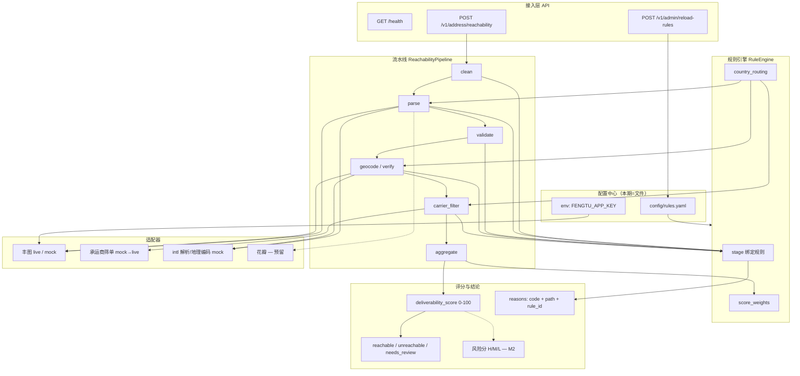
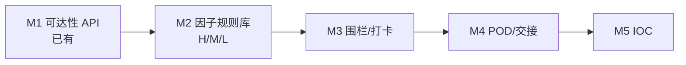

# 地址可达性服务 — 技术架构（对照中国区物流地址管理 PPT）

> **仓库：** https://github.com/jimmysummer079-cmyk/address-reachability-service  
> **本地路径：** `/workspace/address-reachability-service/`  
> **版本：** 0.1.0 · **更新：** 2026-10-24（Asia/Shanghai）  
> **受众：** 架构师 / 工程负责人  
> **输入：** 中国区物流地址管理 PPT 大纲（生成→变更→使用→运营；CRM→SUPPLY 痛点；丰图/花瓣可派送解析；围栏/交接/风险地址运营）  
> **关联：** [DESIGN.md](./DESIGN.md)（API/流水线细节）、[FENGTU_LIVE.md](./FENGTU_LIVE.md)（丰图 2.0 联调）、`/workspace/fengtu-address-risk-solution.md`（双评分企业方案）

---

## 1. 目标与范围

### 1.1 一句话定位

本开源项目是企业「地址主数据 + 可派送/风险」能力中的 **可派送性（Deliverability / Reachability）查询内核**：  
`输入地址 → 清洗/解析/验真/地理编码/承运商筛单 → 规则引擎 → 可达结论 + 原因码(path) + 分数`。

PPT 全景目标是 **正确地址 → 正确收货人**，覆盖 **生成 → 变更 → 使用 → 运营**。本仓库只落地其中 **「使用」阶段的同步判定能力**，以及为运营提供可配置规则与结构化输出契约；其余能力以对接边界或路线图形式保留。

### 1.2 开源项目边界 vs 企业全景

| 维度 | 企业全景（PPT） | 本仓库（开源） |
|------|-----------------|----------------|
| 生命周期 | 生成 / 变更 / 使用 / 运营 | **使用**（查询 API）；规则配置支撑运营的一部分 |
| 系统触点 | CRM、TES、LBS、PSM、MTMS、ORS、isales、二次物流 | **对外 REST**；调用方自行嵌入上述系统 |
| 可派送解析 | 丰图 + 花瓣 → 结构化字段 | **丰图 2.0 live**（`FENGTU_APP_KEY`）或 mock；花瓣未接入（契约预留） |
| 风险评分 | 因子配置 → 规则组合 → H/M/L → 运营动作 | 现有为 **deliverability_score** + stage 规则；**风险因子库 / HML 为 M2** |
| 电子围栏 500m + 拍照热环 | 末端打卡闭环 | **不做实现**；M3 事件接入契约 |
| 交接核验（码/章/人） | 末端交接真实性 | **不做**；M4 |
| POD AI | 乱签收 / 证据链 | **不做**（双分中的 POD 侧）；见企业方案文档 |
| 风险地址 库/探针/IOC | 运营中台 | **不做**；M5 |
| 地址变更 / 二次物流回 CRM | 主数据同步 | **不做业务流**；输出字段可供上游写回 |

### 1.3 本期做 / 不做

| 本期做（已有或文档承诺） | 本期不做 |
|--------------------------|----------|
| `POST /v1/address/reachability` 可达性查询 | CRM/TES/PSM/MTMS/ORS/isales 内嵌改造 |
| 流水线 `clean→parse→validate→geocode/verify→carrier_filter→aggregate` | 电子围栏、打卡、拍照热环实现 |
| `config/rules.yaml` 可配置 stage 规则 + 热加载 | 交接码/章/人核验、POD AI |
| CN：丰图 2.0（oplbs/opsearch/opquery）live 或 mock | 顺丰筛单真实开放平台（现 mock） |
| INT：intl mock + 国别脏样例验收 | 花瓣 live、黄金地址库持久化、IOC 大屏 |
| 原因码 + `path`（字段或 stage） | 替代承运商运单核心系统 |

---

## 2. 业务能力映射表（PPT → 本仓库）

### 2.1 端到端生命周期

| PPT 阶段 | 业务含义 | 本仓库职责 |
|----------|----------|------------|
| **生成** | CRM / isales 录入收货地址 | 不生成主数据；可被录入后同步调用本 API 做规范/可达预检 |
| **变更** | 改址、二次物流回传 CRM | 不实现回传；变更后可再次调用本 API；回写字段见 §5 |
| **使用** | 下单/出库/路由前判定「能否派到」 | **核心**：可达性 API + 规则引擎 + 丰图/承运商适配 |
| **运营** | 地址审核、风险地址、规则调参、IOC | 规则 YAML 可运营；审核队列/IOC/探针为后续 |

### 2.2 痛点 ①–⑨（CRM→SUPPLY）→ 模块

> 编号按 PPT「CRM→SUPPLY」生命周期归纳；若原 PPT 文案与下表措辞略有出入，以「映射模块」为准做架构对齐。

| # | 痛点（归纳） | 建设方向（PPT） | 本仓库模块 / 状态 |
|---|--------------|-----------------|-------------------|
| ① | CRM 脏地址 / 占位符 / 粘连 | 清洗 + 规范性审核规则 | `pipeline` clean + `rules.yaml` CLEAN_* **已有** |
| ② | 未结构化 / 省市区错漏 → 派错人 | 丰图/花瓣解析 → 结构化 | `adapters/fengtu_client.py` parse **已有**；花瓣 **未做** |
| ③ | 无系统化地址审核 | 审核规则 + needs_review | `status=needs_review` + block/warn 规则 **部分**；人工队列 **未做** |
| ④ | 二次物流结果未回 CRM | 回传契约 | **边界**：响应体可供 CRM 写回；同步流 **未做** |
| ⑤ | 地址变更未同步 SUPPLY | 变更事件 + 再校验 | **边界**：调用方触发再查；事件总线 **未做** |
| ⑥ | 下单前未做可达/超区判断 | 可派送性 + 承运商筛单 | `geocode/verify` + `sf_filter_mock` + score **已有**（SF 筛单 mock） |
| ⑦ | 末端无围栏打卡 / 拍照闭环 | e-fence 500m + 热环 | **M3** 事件接入契约 |
| ⑧ | 交接无码/章/人核验 | 交接校验 | **M4** |
| ⑨ | 风险地址无库、无探针、无 IOC | 风险因子→规则→分→运营 | **M2** 因子规则库；**M5** IOC |

### 2.3 关键设计点 → 模块

| PPT 设计点 | 本仓库落点 |
|------------|------------|
| 丰图可派送解析 → 省市区/详细/坐标 | `FengtuClient`：`addressResolve` / `addressidentify` / `addressRealCheck` / `oplbs` geocode |
| 花瓣解析 | 适配器接口同构预留；配置 `parser: huaban` **未实现** |
| TES / LBS / PSM / MTMS / ORS / isales | 均为 **调用方**；本服务提供查询 API（见 §7） |
| 风险因子配置 → 规则组合 → 分数 → 运营 | 现：`score_weights` + stage rules；目标：`factors` + `rule_groups` + H/M/L（§6） |
| 可派送规则 / 规范性审核规则 | `rules.yaml` 按 stage；severity info/warn/block |
| POD AI（后期） | 不在本 API 响应；企业双分文档；本仓 M4 |

---

## 3. 逻辑架构



**运行时模块对应：**

| 层 | 路径 |
|----|------|
| API | `app/main.py` |
| 流水线 | `app/pipeline/runner.py` |
| 规则 | `app/engine/rule_engine.py` + `config/rules.yaml` |
| 模型 | `app/models/schemas.py` |
| 丰图 | `app/adapters/fengtu_client.py` / `fengtu_mock.py` |
| 承运商 | `app/adapters/sf_filter_mock.py` |
| 国际 | `app/adapters/intl_mock.py` |

---

## 4. 部署架构建议

### 4.1 本地开发

```bash
cd /workspace/address-reachability-service
python3 -m venv .venv && source .venv/bin/activate
pip install -r requirements.txt
cp .env.example .env   # 填入 FENGTU_APP_KEY（可选）
# 勿提交 .env；勿 echo 密钥
uvicorn app.main:app --host 0.0.0.0 --port 8080 --reload
```

- Swagger：`http://127.0.0.1:8080/docs`
- 无密钥 → `adapters.fengtu=mock`；有密钥 → `live`

### 4.2 容器（建议，仓库暂无 Dockerfile）

```text
镜像：python:3.11-slim
工作目录：/app
CMD：uvicorn app.main:app --host 0.0.0.0 --port 8080
挂载/注入：
  - config/rules.yaml（或 ConfigMap）
  - 环境变量 FENGTU_APP_KEY（Secret，禁止打进镜像层）
探活：GET /health
无状态：可水平扩展；规则热加载为进程内 reload，多副本需各自 reload 或改为配置中心推送
```

### 4.3 密钥与配置

| 项 | 来源 | 说明 |
|----|------|------|
| `FENGTU_APP_KEY` | env / K8s Secret | Header `ak`；见 FENGTU_LIVE.md |
| `FENGTU_SYSCODE` | 可选 env | addressidentify 用，默认 SysTEST |
| `rules.yaml` | 文件 / 未来配置中心 | `POST /v1/admin/reload-rules` |
| 顺丰开放平台凭证 | **未接** | 接入时同类 Secret，不落库 |

日志：地址属个人信息，生产需脱敏（门牌/电话）；禁止打印 AppKey。

---

## 5. 数据模型（对齐 PPT 可派送性输出）

### 5.1 PPT 期望字段 ↔ 当前响应

| PPT 语义 | 当前字段 | 说明 |
|----------|----------|------|
| 省 / 市 / 区（县）/ 详细 | `parsed.province` / `city` / `district`·`county` / `road`+`house_number`；`cleaned_raw` | 丰图 resolve 另含 town 等，部分在 adapter 内映射 |
| 来源 | `geocode.provider`；pipeline notes；丰图 live 源（resolve/identify） | 建议 M2 显式 `source` 枚举：`fengtu`/`huaban`/`manual`/`crm` |
| 经纬度 | `geocode.lat` / `lng` + `coordinate_system`（CN=GCJ-02） | |
| 等级 | 现用 `status` + `deliverability_score` | PPT H/M/L → M2 `risk_level`；可派送等级可映射：score≥阈值且 reachable→H(通畅)，needs_review→M，unreachable→L |
| 结论 | `reachable` + `status` | `reachable` / `unreachable` / `needs_review` |
| 问题 | `reasons[].code` + `message` | |
| 治理建议 | `reasons[].details` / message 文案 | M2 增加 `remediation` 枚举：补全字段 / 改址 / 人审 / 换产品线 |
| 原因定位 | `reasons[].path` | `address.*` 或 `stage.*` |
| 规则追溯 | `reasons[].rule_id` + `rules_version` | |

### 5.2 原因码 path 约定（已实现）

```text
字段问题：address.country | address.city | address.postal_code | address.raw | …
阶段问题：stage.clean | stage.parse | stage.validate | stage.geocode | stage.verify | stage.carrier_filter
```

稳定机器码示例：`ADDR_INCOMPLETE`、`VERIFY_FAIL`、`GEO_LOW_CONF`、`CARRIER_OUT_OF_SERVICE`、`FENGTU_*`（live 错误）。完整表见 DESIGN.md §4。

### 5.3 建议对外「PPT 视图」投影（兼容层，不必立刻改 breaking schema）

```json
{
  "deliverability": {
    "province": "...", "city": "...", "district": "...", "detail": "...",
    "source": "fengtu",
    "lat": 22.5, "lng": 113.9, "coordinate_system": "GCJ-02",
    "level": "H|M|L",
    "conclusion": "reachable|unreachable|needs_review",
    "problems": [{"code": "...", "path": "...", "message": "..."}],
    "remediation": ["补全市级行政区", "人工审核"]
  },
  "raw_api": { "...": "现有 ReachabilityResponse 原样" }
}
```

---

## 6. 规则配置模型与 `rules.yaml` 演进

### 6.1 现状（v1.0.0）

```text
defaults + country_routing + rules[] + score_weights
rule: id / stage / severity / when / then(action, reason_code, path, message)
```

- **因子**：隐式存在于 when 条件与 score_weights 键（completeness、verify、geocode_confidence…）
- **组合**：按 stage 顺序求值；block → unreachable；soft_fail → needs_review
- **等级**：无显式 H/M/L，由 score 阈值 + status 间接表达

### 6.2 目标模型（M2，向后兼容扩展）

```yaml
version: "2.0.0"
factors:
  - id: FACT_INCOMPLETE
    type: boolean
    extract: "parsed.completeness != sufficient"
  - id: FACT_GEO_CONF
    type: number
    extract: "geocode.confidence"
  - id: FACT_VERIFY_FAIL
    type: boolean
    extract: "verify_ok == false"
  - id: FACT_FILTER_OOS
    type: boolean
    extract: "filter_result == 3"

rule_library:
  - id: RULE_DELIV_BLOCK_INCOMPLETE
    combine: "ALL"          # ALL | ANY | EXPR
    factors: [FACT_INCOMPLETE]
    level: L                # H | M | L
    domain: deliverability  # deliverability | normative_review | risk
    then:
      status: unreachable
      reason_code: ADDR_INCOMPLETE
      path: address.city
      remediation: ["引导用户补全市/邮编"]

  - id: RULE_REVIEW_LOW_GEO
    combine: "EXPR"
    expr: "FACT_GEO_CONF < 0.55"
    level: M
    domain: normative_review
    then:
      status: needs_review
      reason_code: GEO_LOW_CONF
      path: stage.geocode

score_weights: { ... }   # 保留数值分，与 H/M/L 并行
```

**演进路径：**

1. **M1（当前）**：保持 stage 规则不动，对外契约稳定。  
2. **M2a**：在 YAML 增加可选 `factors` / `level` 字段，引擎双读；旧规则无 level 时由 severity+score 推导。  
3. **M2b**：规范性审核规则（normative_review）与可派送规则分 domain，便于 CRM 审核队列消费。  
4. **M2c**：规则迁配置中心；`reload-rules` 改为拉取版本号。

---

## 7. 与 TES / LBS / PSM / MTMS / ORS / isales 的集成边界

```text
                    ┌─────────────────────────────────────┐
  isales / CRM      │  Address Reachability Service        │
  TES / PSM         │  · 可派送性查询 API                   │
  MTMS / ORS / LBS  │  ·（M2）风险等级查询                  │
         │          │  · 规则配置与原因码                   │
         │ 同步HTTP │                                     │
         └─────────►│  不拥有：主数据存储、改址工作流、     │
                    │  围栏几何、打卡照片、POD 证据、IOC    │
                    └─────────────────────────────────────┘
```

| 系统（PPT） | 典型用法 | 本项目提供 | 本项目不提供 |
|-------------|----------|------------|--------------|
| **isales / CRM** | 录入/审核前预检；变更后复检 | Reachability 响应字段写回建议 | 地址主数据 CRUD、审核 UI |
| **TES** | 运输执行前校验目的地可达 | 同上 | 运单状态机 |
| **LBS** | 坐标/围栏能力 | 丰图 geocode 结果；围栏事件 **消费契约（M3）** | 围栏维护、轨迹采集 |
| **PSM** | 履约/履约监控 | 原因码用于拦截或告警标签 | 履约编排 |
| **MTMS** | 运输管理下单/筛单 | 承运商 filter 语义对齐 | 真实下单、路由 |
| **ORS** | 路由/调度 | 可达结论作约束输入 | 路径规划本身 |
| **二次物流** | 改址回 CRM | 无状态查询可重复调用 | 回传消息总线 |

**对接契约原则：**

1. 本服务 **无会话、无地址 ID 必填**（可后续加 `address_id` 透传字段）。  
2. 变更/围栏/POD 由上游推送事件；本服务 M3/M4 只定义可选 webhook/事件 schema，不实现业务闭环。  
3. 双分：本 API = Deliverability；PODRisk 另服务或同进程后续模块，禁止混成单一「地址分」对外。

---

## 8. 演进路线图

| 里程碑 | 内容 | 状态 |
|--------|------|------|
| **M1** 可达性 API | FastAPI + 流水线 + rules.yaml + 丰图 live/mock + SF/intl mock | **已有** |
| **M2** 风险因子规则库 | factors + rule_library + H/M/L + remediation；规范性/可派送分域；可选风险查询 API | 规划 |
| **M3** 围栏/打卡事件接入 | 消费 500m check-in / 拍照热环事件；与 geocode 点做距离校验；原因码 `FENCE_*` | 规划 |
| **M4** POD / 交接校验 | 码/章/人核验接口或事件；PODRiskScore 边界；不替代承运商签收 | 规划 |
| **M5** IOC | 风险地址库、探针任务、运营大屏指标；本仓可仅提供聚合查询 API | 规划 |



---

## 9. 架构结论（给评审）

1. **本开源仓 = 可派送性判定内核**，不是中国区地址中台全家桶。  
2. PPT 的生成/变更/运营闭环依赖 **CRM·TES·LBS 等调用方**；本仓用稳定 API + 原因码 path 把「能否派到、问题在哪」说清楚。  
3. 丰图 2.0 已是 CN 主路径；花瓣、真实 SF 筛单、围栏、交接、IOC 按 M2–M5 挂接，避免 scope 膨胀。  
4. 规则从「stage 命令式 YAML」演进到「因子 → 组合 → H/M/L」，且必须向后兼容现网 `rules.yaml`。  
5. Deliverability 与 POD 继续分轨；本 API 近期仍不返回 PODRiskScore。
